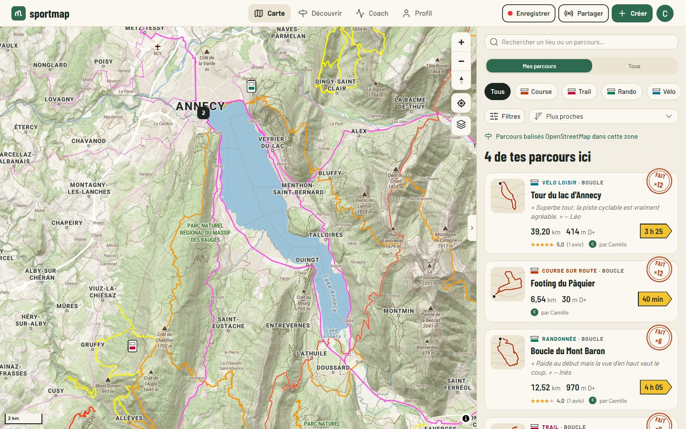
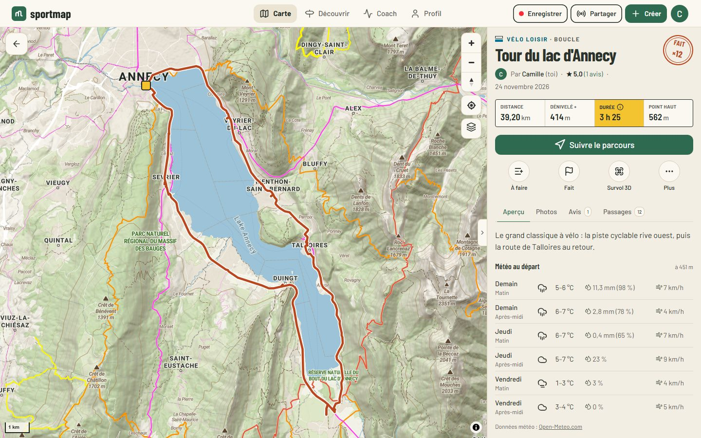
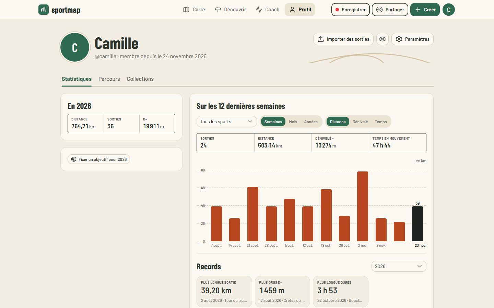

# sportmap

[](https://github.com/clementdhs/sport-map/actions/workflows/ci.yml)

Crée, partage et découvre des parcours de course à pied, randonnée et vélo sur une carte — application web installable (PWA).

**Stack** : Nuxt 4 · Nuxt UI · Pinia · Supabase (Postgres + PostGIS, Auth, Storage) · MapLibre GL + MapTiler · OpenRouteService

## Aperçu

Tes parcours sur la carte, filtrés par sport, avec leur durée estimée à ton allure :



<table>
  <tr>
    <td width="68%"></td>
    <td width="32%" rowspan="2"></td>
  </tr>
  <tr>
    <td>La page d'un parcours : statistiques, météo au départ, avis et sorties. Sur mobile, le détail tient dans un panneau coulissant.</td>
  </tr>
</table>

L'éditeur suit les chemins entre les points, calcule le dénivelé et le profil, et génère des boucles :


Les statistiques de tes sorties, semaine par semaine, et tes records :



<sub>Captures faites avec des données de démo fictives (`npm run screenshots`). Fonds de carte © MapTiler © contributeurs OpenStreetMap.</sub>

## Installation

Prérequis : Node.js 22+.

```bash
npm install
cp .env.example .env
```

### 1. Clés à renseigner dans `.env`

| Variable | Où la trouver |
| --- | --- |
| `NUXT_PUBLIC_SUPABASE_URL`, `NUXT_PUBLIC_SUPABASE_KEY` | [Supabase](https://supabase.com) → projet → *Project Settings > API Keys* (clé *publishable*) |
| `NUXT_PUBLIC_MAPTILER_KEY` | [MapTiler Cloud](https://cloud.maptiler.com/account/keys/) — restreins la clé à tes domaines |
| `NUXT_OPENROUTESERVICE_KEY` | [OpenRouteService](https://openrouteservice.org/dev/) (nécessaire à partir de l'éditeur « suivre les routes ») |

Sans clé MapTiler, la carte utilise les tuiles de démonstration MapLibre (très peu détaillées).

### 2. Base de données

```bash
npx supabase login
npx supabase link --project-ref <ref-du-projet>
npm run db:push     # applique supabase/migrations
npm run db:types    # régénère shared/types/database.types.ts
```

Dans Supabase → *Authentication > URL Configuration* : Site URL `http://localhost:3000` et ajoute `http://localhost:3000/confirm` aux Redirect URLs (plus l'URL de production le moment venu).

### 3. Lancer

```bash
npm run dev
```

Puis ouvre http://localhost:3000.

## Scripts

| Commande | Rôle |
| --- | --- |
| `npm run dev` | serveur de développement, sur le Supabase en ligne |
| `npm run dev:local` | serveur de développement, sur le Supabase local (après `npm run db:start`) |
| `npm run build` / `npm run preview` | build de production / prévisualisation |
| `npm run typecheck` | vérification TypeScript |
| `npm test` | tests unitaires et du store (Vitest), sans réseau |
| `npm run db:start` / `npm run db:stop` | démarre / arrête Supabase en local (Docker) |
| `npm run test:e2e` | tests de bout en bout (Playwright), sur Supabase local |
| `npm run screenshots` | régénère les captures du README (`docs/screenshots`), sur Supabase local avec des données de démo et les vraies tuiles MapTiler (`SCREENSHOTS_SKIP_BUILD=1` réutilise le build) |
| `npm run db:push` | applique les migrations au projet Supabase lié |
| `npm run db:types` | régénère les types de la base |

## Tests

- **Unitaires et store** (`test/unit`, `test/nuxt`) : `npm test`. Aucun réseau ni base de données ; les appels d'API sont simulés.
- **De bout en bout** (`test/e2e`) : nécessite [Docker Desktop](https://www.docker.com/products/docker-desktop/) démarré.

  ```bash
  npm run db:start      # Supabase local, avec les migrations du repo
  npm run test:e2e      # build de production + navigateur Chromium
  ```

  Tous ces tests tournent aussi automatiquement sur GitHub Actions à chaque push (`.github/workflows/ci.yml`), sans aucun secret : les types et les tests unitaires dans un job, les tests de bout en bout dans un autre, en parallèle. Un push qui ne touche que des fichiers `.md` ou `.claude/` ne lance pas la CI.

  Les tests visent uniquement le Supabase local (jamais le projet en ligne). Ils recréent à chaque lancement un compte et un parcours de test, et simulent le fond de carte et le calcul d'itinéraire : aucun quota MapTiler ou OpenRouteService n'est consommé. Premier lancement : `npx playwright install chromium`.

## Garder Supabase actif

Un projet Supabase gratuit est mis en pause après 7 jours sans activité. Le workflow `.github/workflows/keep-supabase-awake.yml` lit la base une fois par jour pour l'en empêcher ; GitHub envoie un e-mail s'il échoue. Il a besoin, dans les réglages du dépôt (*Settings → Secrets and variables → Actions*) :

- la **variable** `SUPABASE_URL` : l'URL du projet (`https://<ref>.supabase.co`) ;
- le **secret** `SUPABASE_PUBLISHABLE_KEY` : la clé publishable du projet.

Pour le lancer à la main : onglet *Actions* → « Garder Supabase actif » → *Run workflow*.

## Quota MapTiler

L'offre gratuite de MapTiler s'arrête à 100 000 requêtes par période de facturation, sans prévenir. Le workflow `.github/workflows/maptiler-quota.yml` lit chaque jour la consommation de la période en cours (API Analytics) et, au-delà du seuil, ouvre une issue « Quota MapTiler à N % » (ou met à jour celle qui est ouverte) ; il la ferme quand la consommation repasse sous le seuil. Il a besoin, dans les réglages du dépôt :

- le **secret** `MAPTILER_SERVICE_TOKEN` : un jeton de service MapTiler Cloud (*Credentials*) ;
- en option, les **variables** `MAPTILER_QUOTA` (100000 par défaut) et `MAPTILER_ALERT_PERCENT` (70 par défaut).

Pour le lancer à la main : onglet *Actions* → « Quota MapTiler » → *Run workflow*.

## Suivi des erreurs (Sentry)

Les erreurs du navigateur et du serveur remontent à [Sentry](https://sentry.io) en production, sans donnée personnelle (ni cookies, ni en-têtes, ni paramètres d'URL, ni utilisateur). Les erreurs « normales » (404, connexion requise…) sont ignorées. Sans DSN, rien n'est envoyé : c'est le cas en local et dans les tests.

Variables d'environnement Vercel (*Settings → Environment Variables*) :

| Variable | Rôle |
| --- | --- |
| `NUXT_PUBLIC_SENTRY_DSN` | active l'envoi des erreurs (le DSN du projet Sentry, public par nature) |
| `SENTRY_AUTH_TOKEN` | secret, au build : envoie les cartes des sources pour des piles d'appels lisibles |
| `SENTRY_ORG` / `SENTRY_PROJECT` | identifiants (slugs) de l'organisation et du projet Sentry |

Pour vérifier : connecté au site, ouvre `/api/_sentry-test` ; l'erreur « Test Sentry : erreur serveur volontaire » doit apparaître dans Sentry.

## Structure

```
app/            pages, composants, layouts (Nuxt 4)
server/api/     routes API (Nitro)
shared/types/   types partagés app/serveur (dont types de la base)
supabase/       config CLI et migrations SQL
test/           unit (Vitest, Node), nuxt (Vitest, environnement Nuxt), e2e (Playwright)
```
